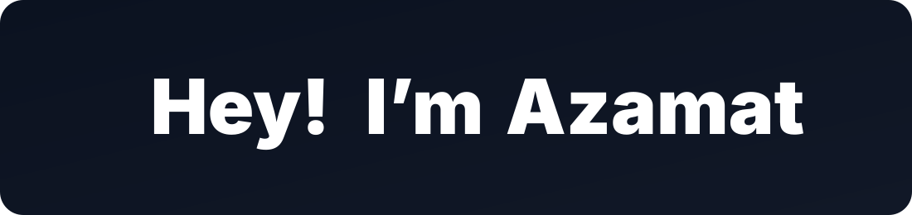

<div align="center">

  <!-- Hero Banner -->
  <a href="https://outletking.co.kr" target="_blank">
    
  </a>

  <br/><br/>

  <!-- Typing Subtitle -->
  

  <br/>

  <p align="center">
    📍 <strong>Seoul, South Korea 🇰🇷</strong> &nbsp;|&nbsp;
    💻 <strong>Full-Stack Engineer</strong> &nbsp;|&nbsp;
    🛠️ <strong>4+ years in production</strong>
  </p>

  <!-- Badges Row -->
  <p align="center">
    <a href="https://outletking.co.kr" target="_blank">
      
    </a>
    <a href="mailto:solijonov.azamat9507@gmail.com">
      
    </a>
  </p>

  <!-- Quick Links -->
  <p align="center">
    <a href="https://outletking.co.kr" target="_blank">🌐 <b>Outlet King (live)</b></a>
    &nbsp;&nbsp;•&nbsp;&nbsp;
    <a href="mailto:solijonov.azamat9507@gmail.com">📫 <b>Email</b></a>
  </p>

</div>

---

### 👨‍💻 Summary

```yaml
engineer:
  name: "Azamat Solijonov"
  title: "Full-Stack Engineer"
  experience: "4+ years building and running production web applications"
  location: "Seoul, South Korea 🇰🇷"
  backend:
    - "Node.js, TypeScript, NestJS (monorepo), Express, GraphQL (Apollo, code-first), REST"
    - "MongoDB, Mongoose, Redis, BullMQ, WebSocket, Server-Sent Events"
  integrations:
    - "Kakao Login and Google sign-in (OAuth 2.0 / OpenID Connect, server-side code exchange)"
    - "Kakao Maps (store locator with geocoded addresses)"
  ai:
    - "Google Gemini API (text + image), multi-model failover with timeouts"
    - "Asynchronous image job pipelines with live progress"
  frontend:
    - "React, Next.js, Apollo Client, Redux, MUI, SCSS, i18next (EN / KR / RU)"
  devops:
    - "Linux, Nginx, PM2, Docker, DigitalOcean, scripted deploys with rollback"
  current_role: "Full-Stack Engineer (main developer) @ Outlet King"
  languages: "Uzbek, Russian, Korean (TOPIK 4), English"
```

- 🧩 **End-to-end ownership:** I take a product from data model to production — API, frontend, infrastructure and the deploy scripts that ship it.
- ⚡ **GraphQL backends on NestJS:** Code-first Apollo APIs with JWT guards (required, role-based, optional), strict input validation and MongoDB aggregation pipelines.
- 🤖 **LLM features in production:** A Gemini AI stylist with 3-model failover on error or an 8 s timeout, and an AI fitting room running as BullMQ jobs on Redis with live SSE progress and per-visitor rate limiting.
- 🔐 **Social login and maps:** Kakao Login and Google sign-in over OAuth 2.0, with the one-time code exchanged on the server so the client secret never reaches the browser and redirect URIs checked against an allow-list; a Kakao Maps store locator where the map and the shop list follow each other.
- 🎨 **Frontend systems:** Next.js apps with their own MUI + SCSS design system, dark / light themes, three languages and real-time WebSocket notifications.
- ☁️ **Self-managed infrastructure:** Nginx reverse proxy, PM2, UFW, Redis, nightly batch jobs and scripted deploys with automatic rollback on DigitalOcean.

---

### 🚀 Featured Projects

<table>
  <thead>
    <tr>
      <th width="30%">Project</th>
      <th width="50%">Architecture & Capabilities</th>
      <th width="20%">Status / Links</th>
    </tr>
  </thead>
  <tbody>
    <tr>
      <td>
        <b>👑 Outlet King</b><br/>
        <sub>Fashion Outlet Marketplace</sub>
      </td>
      <td>
        Production marketplace running in English, Korean and Russian. ~28k lines of TypeScript across a <b>NestJS monorepo</b> (API + batch worker) and a <b>Next.js</b> app: 19 modules, 57 GraphQL queries and mutations, 12 MongoDB models. Gemini AI stylist and an asynchronous AI fitting room on BullMQ + Redis with SSE progress. Kakao and Google social login, Kakao Maps store locator. 25 pages, 78 components.
      </td>
      <td>
        <a href="https://outletking.co.kr" target="_blank"><code>outletking.co.kr</code> ↗</a><br/>
        <code>Production</code><br/>
        Main developer
      </td>
    </tr>
    <tr>
      <td>
        <b>☕ Cafena</b><br/>
        <sub>Coffee Marketplace</sub>
      </td>
      <td>
        Full-stack marketplace on Node.js / Express and React: search, reviews, orders, franchise directory and real-time updates over Socket.IO. 9 Mongoose schemas, React + Redux + MUI client, server-rendered admin panel for shops and advertising. Deployed with Docker, Nginx and PM2.
      </td>
      <td>
        <code>Private repository</code>
      </td>
    </tr>
    <tr>
      <td>
        <b>🛒 E-commerce Storefronts</b><br/>
        <sub>Freelance · Uzbekistan</sub>
      </td>
      <td>
        Production storefronts delivered directly with clients from scoping to launch. Frontend architecture with React, TypeScript and Redux on REST backends: catalogs, filtering, product pages, multi-currency pricing and responsive layouts.
      </td>
      <td>
        <a href="https://fpg.uz" target="_blank"><code>fpg.uz</code> ↗</a><br/>
        <a href="https://tovar.uz" target="_blank"><code>tovar.uz</code> ↗</a><br/>
        <a href="https://mytech.uz" target="_blank"><code>mytech.uz</code> ↗</a><br/>
        <a href="https://four.uz" target="_blank"><code>four.uz</code> ↗</a>
      </td>
    </tr>
    <tr>
      <td>
        <b>🏢 Nestar</b><br/>
        <sub>Real-Estate Marketplace</sub>
      </td>
      <td>
        Real-estate marketplace with a NestJS monorepo backend and a Next.js 14 frontend using Apollo Client, MUI and i18next.
      </td>
      <td>
        <a href="https://github.com/Azamat9507/nestar-next"><code>nestar-next</code> ↗</a>
      </td>
    </tr>
    <tr>
      <td>
        <b>🍽️ Burak</b><br/>
        <sub>Restaurant Ordering Service</sub>
      </td>
      <td>
        REST backend on Node.js, Express and TypeScript with MongoDB: members, product catalogue, orders, JWT auth and a server-rendered EJS admin panel for the restaurant.
      </td>
      <td>
        <a href="https://github.com/Azamat9507/burak"><code>burak</code> ↗</a>
      </td>
    </tr>
  </tbody>
</table>

---

### 🛠️ Technical Stack

<br/>

<table>
  <tr>
    <td width="22%" align="center"><b>🤖 AI & Queues</b></td>
    <td>
      
      
      
      
    </td>
  </tr>
  <tr>
    <td width="22%" align="center"><b>🔐 Auth & Maps</b></td>
    <td>
      
      
      
      
    </td>
  </tr>
  <tr>
    <td width="22%" align="center"><b>💻 Languages</b></td>
    <td>
      
    </td>
  </tr>
  <tr>
    <td width="22%" align="center"><b>⚡ Backend & Data</b></td>
    <td>
      
    </td>
  </tr>
  <tr>
    <td width="22%" align="center"><b>🎨 Frontend</b></td>
    <td>
      
    </td>
  </tr>
  <tr>
    <td width="22%" align="center"><b>☁️ DevOps</b></td>
    <td>
      
      
      
    </td>
  </tr>
  <tr>
    <td width="22%" align="center"><b>🧪 Tools</b></td>
    <td>
      
    </td>
  </tr>
</table>

---

### 📬 Connect

<div align="center">

  <a href="https://outletking.co.kr" target="_blank">
    
  </a>
  &nbsp;
  <a href="mailto:solijonov.azamat9507@gmail.com">
    
  </a>

</div>
